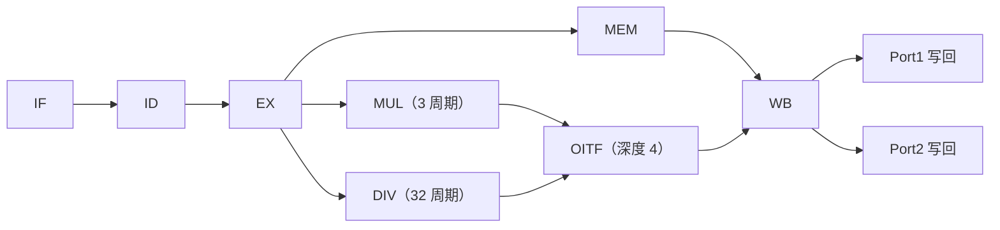
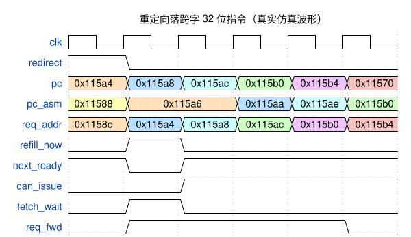

# BD32 Core 微架构

> 本文档聚焦处理器核微架构实现。芯片级权威规格（存储器映射/时钟树/复位树/中断映射/寄存器复位值与访问类型）见 [spec.md](spec.md)。

## 概览

BD32 是 32 位 RV32IMC 处理器核（含 Zcb、Zba/Zbb/Zbs、Zcmp 扩展），经典 5 级流水线（IF → ID → EX → MEM → WB），配备深度 4 的 OITF（乱序退休 FIFO），让多周期乘除指令可与短指令并行执行、乱序写回。

**交互式核组件架构图**：[bd32_core_architecture.html](bd32_core_architecture.html)。简图如下：

## 流水线

- 短指令（ALU / Load / Store / Branch）走正常 5 级流水，WB 阶段经 Port1 写回。
- 长指令（MUL/DIV/REM）在 EX 阶段分发到 OITF，由独立功能单元执行，完成后经 Port2 乱序写回。
- OITF 维护 RAW/WAW 冒险检测，必要时 stall 整条流水线。
- 寄存器堆双写端口：Port1（正常 WB）与 Port2（OITF 退休），同地址冲突时 Port2 优先；旁路读取优先级 Port2 > Port1 > 寄存器阵列。

## 取指（IFU_Buffer + RVC/Zcmp 展开器）

- **IFU_Buffer**：替代传统 PC_counter，负责 16/32 位指令装配。取指按字流推进，装配器按 `pc_asm[1]` 与指令长度编码从 `{cur_w, w_new}` 中切出 16/32 位指令；跨字 32 位指令（起始于奇数半字）由 `{w_new[15:0], cur_eff[31:16]}` 拼接。
  
  下图为重定向目标为跨字 32 位指令的情况（理论上只有这种情况会停顿一拍）：目标指令 I 起始于奇数半字 0x115a6（占 0x115a6~0x115a9，跨 0x115a8 字边界），故 T0 拍重定向后 pc_asm 由旧流的 0x11588 直接跳至 0x115a6，属重定向落点而非顺序推进。请求与数据天然错开一拍——T0 拍 redirect 当拍把目标字 0x115a4 组合驱动到存储器口；T1 拍目标字数据返回（refill_now 当拍补装）并前推请求 0x115a8，此时跨字后半未到，fetch_wait 停顿 1 拍；T2 拍第二字返回、拼接发射，req_fwd 切至 crossing 项请求 0x115ac；此后恢复每拍一条的连续流（pc_asm 逐指令推进 0x115aa → 0x115ae → 0x115b0），末拍 pc 跳至 0x11570 为 BTB 预测命中循环回边（predict_redirect 组合切换，不冲刷当前指令）。
  
  典型时序与图中信号说明如下（图取自真实仿真波形）：
  
    - `pc`：取指请求字地址，当拍组合驱动到存储器口（指令数据下一拍经 w_new 返回）；
    - `pc_asm`：装配指针，当前指令地址（16 位对齐）——消费侧指针，与请求侧 `pc` 解耦；
    - `req_addr`：上一拍请求字的在途标签（本拍 w_new 所属字地址，与 `pc` 恒差一拍）；
    - `redirect`：流水线重定向（跳转解析/调试恢复），当拍作废发射并按目标地址重新取指；
    - `refill_now`：窗口空且请求字恰为装配字，当拍直接补装；
    - `next_ready`：跨字指令第二字就绪（可与窗口字拼接发射）；
    - `can_issue`：本拍可发射一条指令；
    - `fetch_wait`：取指停顿（等待下一字返回）；
    - `req_fwd`：预取前推（请求地址当拍前移至消费字 +4）。
  
    
  
- **RVC_Expander**：纯组合的 RV32C→RV32I 展开器（完整 RV32IMC + Zcb：c.lbu/c.lhu/c.lh/c.sb/c.sh/c.mul/c.zext.b/c.not 及依赖 Zbb 的 c.zext.h/c.sext.b/c.sext.h；不含 F/D；C2 象限的 Zcmp 编码只做合法性识别，展开交给 Zcmp_Expander；保留编码置 illegal，hint 展开为 NOP）。压缩指令在 IF 阶段展开为 32 位等价指令，Decoder/Executer 零改动；链接地址语义（C.JAL/C.JALR 的 pc+2）由流水线 `is_compressed` 标志处理（`inst_addr_plus_len = pc + (is_compressed ? 2 : 4)`）。

- **Zcmp_Expander**：通过FSM把 cm.push/cm.pop/cm.popret(z)/cm.mvsa01/cm.mva01s 逐拍展开为标准 lw/sw/addi/jalr 微操作流；展开期间冻结取指/装配并屏蔽中断、调试事件（halt/断点以整条 Zcmp 指令为粒度），busy 保持到最后一个微操作 WB 退休，HPM 按整条 1 条架构指令计数。cm.popret(z) 的尾拍微操作是 jalr：展开期默认屏蔽预测，仅该 ret 微操作恢复预测。

## 运算单元

- 乘法：4 级流水基 4 Booth 乘法器（S0 输入+部分积 → S1 压缩 → S2 CLA+修正 → S3 输出；每拍可接受新输入）。
- 除法：32 周期迭代恢复余数除法器。
- 位操作（Zba/Zbb/Zbs）：全部单周期实现于 EX 级（andn/orn/xnor、min/max、sh1-3add、rol/ror、clz/ctz/cpop、rev8/orc.b、单比特置位/清除/反转/提取及其立即数形式），走正常流水线不占用 OITF。

## 分支预测

分支预测单元（BPU）采用 **Gshare（方向）+ BTB（目标地址）+ RAS（调用/返回）** 方案：

- **方向预测（Gshare）**：PHT 存 2 位饱和计数器，索引 = PC 哈希值 ⊕ 全局历史寄存器（GHR）；GHR 记录最近分支的实际跳转方向，利用分支间相关性提高准确率。
- **目标地址（BTB）**：直接映射，每项含 Valid / Type / Tag / Target；以 PC 低位索引，查得的 Target 与 PC 高位拼接（压缩 Tag/Target 位宽、省面积，略微增加别名）。
- **返回地址（RAS）**：JAL（rd=x1/x5）视为调用入栈，RET（JALR 且 rs1 为 link 类）出栈；BTB 指令类型为 RET 时取 RAS 栈顶作为预测地址。JALR 的入栈/出栈按 RISC-V 规范表（rd/rs1 是否 link、rs1=rd）执行。
- **两阶段流程**：IF 推测（按 PC 查 BTB/PHT，RET 用 RAS 栈顶）；EX 更新（PHT 计数器、GHR 移位写入实际方向、BTB 新增/修改、RAS 压栈/出栈）。
- PC 更新优先级：中断/异常 > 分支预测失败（EX）> 预测跳转（IF）> 停顿 > PC+4。
- 调试单步模式下自动门控预测跳转，保证 PC 严格 +4 递增。
- 分支预测器 BTB/RAS 按 16 位对齐索引（ALIGN_WIDTH=1；BTB index 含半字位 pc[8:1]，跨字 jal 与对齐 PC 不再混叠同一条目）；RAS 压栈使用 EX 级计算好的实际链接地址（32 位 call +2 半字 / 16 位 call +1 半字），返回预测不会错位；cm.popret(z) 尾拍 ret 微操作按普通 RET 参与 BTB 训练（Type=RET）与 RAS 出栈。

## 总线接口与系统集成

- 核侧仅一个 AXI-Lite 主机口，取指与访存分时复用（取指字被 LSU/SBA 抢占时由 fetch_served 通知 IFU 重发）。
- SoC 侧拓扑：AXI_Interconnect → APB 桥 → PSEL[6:0] 七从机译码（每从机 64KB，`[31:16]` 匹配）；Flash/DDR 留空段挂 axi_err_slave（恒 OKAY + 读 0），其余未路由段无从机响应、靠总线超时 DECERR 有界返回；错误响应模型见 [spec.md](spec.md) §3/§9。
- 时钟：CPU/总线/外设同域（clk_cpu，62.5MHz）；CLINT mtime 独立 1MHz 域（mtime/mtimecmp 跨域为两处 CDC 边界之一，另一处为 JTAG TCK）。

## 中断与异常

- **中断接受（指令边界）**：中断挂起且 MIE 开启时，在 EX 级指令边界接受——冲刷 IF_ID、ID_EX 与 EX_MEM（EX 级边界指令连同其执行结果一并作废），mepc 锁存边界指令 PC，mret 后重新执行该指令；已越过 EX_MEM 的更老指令（MEM/WB 级）照常提交。
- **多重窗口延后接受**：EX 级分支未决/重定向拍、流水线停顿（OITF/总线/非对齐访存）、Zcmp 展开期间、mret 后 gap 数拍内均延后中断接受，避免边界错位。
- **异常（同步）**：当拍按故障指令所在级（sel_stage）部分冲刷；陷阱码经 get_priority 优先级选择（IF 访错 > ID 非法/ecall/ebreak > EX 访错/非法 CSR/未对齐），无异常级为全 1 默认值。
- Debug halt/断点为独立通路（不影响架构状态），详见[调试模块](debug_module.md)。

## 调试

- 核通过专用端口与 Debug Module 交互（halt/resume/step、GPR/CSR 直连、SBA 总线访问、Trigger 断点/观察点、ebreak 进调试）。
- Debug Module 不占系统地址空间（非内存映射外设），经 JTAG DMI 访问；SBA 按地址在核内分发——BootROM/ITCM/DTCM 直连，总线区（外设等）借用 CPU 侧总线主机口发起事务。
- 详见[调试模块](debug_module.md)。
