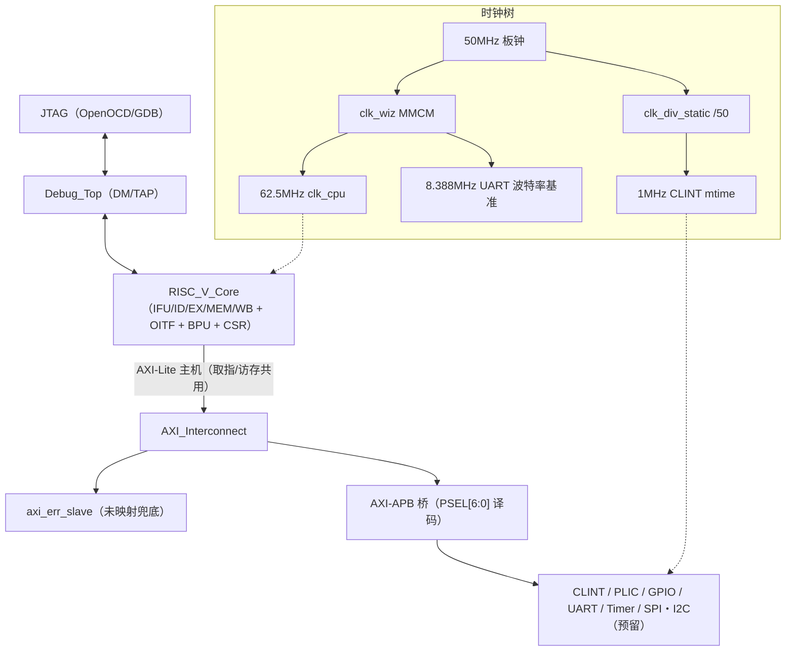

# BD32 芯片规格书（Chip Specification）

> 本文档是 BD32 SoC 的**权威规格**：寄存器复位值/访问类型、中断编号、时钟与复位架构以此为准（数值从 RTL 实读提取，提取记录见 `stage1_spec_extraction.json` / `stage2_spec_review.json`）。
> 配套文档：微架构实现细节见 [architecture.md](architecture.md)；固件编程见 [sdk.md](sdk.md)；外设编程速查见 [peripherals.md](peripherals.md)；验证流程见 [verification.md](verification.md)。

## 1. 项目概览

- 设计名称：BD32——RV32IMC 自研 SoC（Zcb/Zba/Zbb/Zbs/Zcmp/Zicond 扩展），5 级流水 + OITF 深度 4 乱序退休 + Gshare/BTB/RAS 预测。
- 实现平台：FPGA 原型——AMD ZYNQ xc7z020clg400-2（PL 部分），Vivado 2023.1。工艺/功耗/供电不适用（FPGA 平台豁免，ASIC 化时需重新评估并补录）。
- 目标频率：clk_cpu 62.5MHz（时序收敛签核值，WNS MET）；UART 波特率基准 8.388608MHz；CLINT 计时 1MHz。
- 顶层模块：`bd32_board_top`（板级：时钟/复位生成）→ `SoC_top`（数字 IP：核 + 总线 + 外设 + Debug）→ `RISC_V_Core`。

## 2. 系统框图

总线主机仅一个（CPU 侧 AXI-Lite）；SBA 调试访问借用同一主机口。

## 3. 存储器映射（权威表）

| 区域 | 基地址 | 结束地址 | 大小 | 总线 | 说明 |
|------|--------|----------|------|------|------|
| BootROM | 0x0000_0000 | 0x0000_0FFF | 4KB | 核内直连 | 复位向量，MROM 测频→UART 引导→跳 ITCM |
| ITCM | 0x0001_0000 | 0x0001_FFFF | 64KB | 核内直连 | 代码，同步读 + 字节写使能，FENCE.I 冲刷 |
| DTCM | 0x0002_0000 | 0x0002_FFFF | 64KB | 核内直连 | 数据，WRITE_FIRST 读回 |
| GPIO | 0xE000_0000 | 0xE000_FFFF | 64KB | APB(PSEL2) | 8 位，输入 2 级同步 |
| UART | 0xE001_0000 | 0xE001_FFFF | 64KB | APB(PSEL3) | 16550 子集 + BootROM 下载通道 |
| Timer | 0xE002_0000 | 0xE002_FFFF | 64KB | APB(PSEL4) | 16 位基本定时器 + 4 通道 IC/OC |
| SPI（预留） | 0xE003_0000 | 0xE003_FFFF | 64KB | APB(PSEL5) | 未实现，访问返回错误 |
| I2C（预留） | 0xE004_0000 | 0xE004_FFFF | 64KB | APB(PSEL6) | 未实现，访问返回错误 |
| PLIC | 0xFC00_0000 | 0xFC00_FFFF | 64KB | APB(PSEL1) | 16 源 / 7 级优先 / 1 目标 |
| CLINT | 0xF200_0000 | 0xF200_BFFF | 48KB | APB(PSEL0) | msip / mtimecmp / mtime |
| Flash / DDR | 0x9000_0000 / 0xB000_0000 | — | — | AXI | 未实现，axi_err_slave 返回错误 |
| 其他未映射 | — | — | — | — | axi_err_slave 兜底（DECERR，有界返回） |

重叠检查：各段基址按 `[31:16]` 译码、64KB 自然对齐，无重叠；保留/扩展余量即未映射段（由错误从机兜底，访问不挂死）。

## 4. 时钟架构

| 时钟 | 频率 | 来源 | 域 |
|------|------|------|-----|
| sys_clk | 50MHz | 板载晶振 | 板级输入 |
| clk_cpu | 62.5MHz | clk_wiz MMCM CLKOUT1（输入 50MHz） | CPU / 总线 / 外设 PCLK |
| clk_8m388 | 8.388608MHz | clk_wiz MMCM CLKOUT2 | UART 波特率基准（115200 精确整除） |
| clk_1mhz | 1MHz | sys_clk / 50（clk_div_static） | CLINT mtime（1 tick = 1µs） |

- **CDC 边界（仅两处）**：① clk_cpu ↔ clk_1mhz（CLINT mtime/mtimecmp 跨域，比较与中断输出在 mtime 域，CSR 影子在 CPU 域同步采样）；② clk_cpu ↔ JTAG TCK（debug_cdc 同步器）。综合侧对应 false_path 约束。
- 无门控时钟（FPGA 原型豁免）；clk_16mhz 为 board_top 遗留声明，无 MMCM 输出连接（开放问题 Q2）。

## 5. 复位架构

- 极性：全低有效（`*_n`）；模式：**异步断言、同步释放**。
- 复位公式：`rst_async_n = sys_rst_n（按键）&& ~dbg_rst（FTDI ADBUS5）&& clk_wiz_locked`——三条件全满足才释放。
- 复位树：

| 复位 | 生成路径 | 覆盖范围 |
|------|----------|----------|
| rst_n_sync（SoC 域） | rst_async_n → BUFG → Cdc_Sync 3 级同步释放 | SoC_top 全部 PRESETn（核、总线、外设、CSR） |
| rst_n_clint_sync（CLINT 域） | 同构 Cdc_Sync 3 级（目的时钟 sys_clk） | clk_div_static 使能门 + CLINT |
| Debug 域 | DM/JTAG 复位独立，**不受 ndmreset 影响** | 调试器复位 SoC 时 Debug Module 必须存活 |

- 上电序列：按键释放 → MMCM locked → 同步释放逐级展开；BootROM 从 MROM 起跑（测频 → UART 引导）。
- CSR 复位值要点：全 0；`mcountinhibit` 复位 0 = 上电全计数（BootROM 测频依赖 mcycle 复位即计数）；`mcause/mepc/mtval` 复位 0。

## 6. 中断映射

| 编号 | 来源 | 触发类型 | 清除机制 | 说明 |
|------|------|----------|----------|------|
| PLIC 源 0 | 保留 | — | — | 恒 0（SVA `a_soc_plic_src0_silent` 固化） |
| PLIC 源 1 | UART | 电平 | 读 IIR/操作 FIFO 按 16550 规则 | IIR 报 5 类子源（RLS/RDA/超时/THRE/MSR） |
| PLIC 源 2 | GPIO | 电平或边沿（TR_TYPE 逐位可配） | 写 1 清 TR_STAT | TR_STAT × IRQ_EN 门控 |
| PLIC 源 3 | Timer | 电平 | 写 1 清 TIMx_SR 对应位 | 溢出/捕获/比较 |
| PLIC 源 4–15 | 未用 | — | — | 恒 0（SVA `a_soc_plic_unused_zero` 固化） |
| mip[3]（软件） | CLINT msip | 电平 | 写 msip bit0=0 | 不经 PLIC，直连 CSR |
| mip[7]（定时） | CLINT mtime≥mtimecmp | 电平 | 软件重装 mtimecmp（电平语义约定） | 不经 PLIC，直连 CSR；mtimecmp 复位 0 → 复位后挂起恒真，**软件使能 mie[7] 前必须先写 mtimecmp** |
| mip[11]（外部） | PLIC irq_o[0] | 电平 | PLIC Complete | 核内固定优先级：外部 > 软件 > 定时 |

调试事件（halt/step/trigger/ebreak）不经中断控制器：直接冻结流水线，不产生 trap、不写 mcause。

## 7. 外设寄存器表（含复位值与访问类型）

### 7.1 GPIO（0xE000_0000，DATA_WIDTH=8）

| 偏移 | 寄存器 | 访问 | 复位值 | 说明 |
|------|--------|------|--------|------|
| 0x00 | MODE | R/W | 0x00 | 0=推挽 1=开漏（逐位） |
| 0x04 | DIRECTION | R/W | 0x00 | 0=输入 1=输出 |
| 0x08 | OUTPUT | R/W | 0x00 | 输出数据 |
| 0x0C | INPUT | RO | 0x00 | 2 级同步采样，不受方向影响 |
| 0x10 | TR_TYPE | R/W | 0x00 | 0=电平 1=边沿（逐位） |
| 0x14 | TR_LVL0 | R/W | 0x00 | 低电平/下降沿 |
| 0x18 | TR_LVL1 | R/W | 0x00 | 高电平/上升沿 |
| 0x1C | TR_STAT | R/W1C | 0x00 | 触发状态，写 1 清零；硬件置位与写清同拍时先置后清 |
| 0x20 | IRQ_EN | R/W | 0x00 | 逐位中断使能 |
| 0x24 | BOP_SET | WO | — | 写 1 原子置位输出位 |
| 0x28 | BOP_CLR | WO | — | 写 1 原子清零输出位（读回值未定义，开放问题 Q4） |

### 7.2 UART（0xE001_0000，16550 子集 + 下载通道）

| 偏移 | 寄存器 | 访问 | 复位值 | 说明 |
|------|--------|------|--------|------|
| 0x00 | RBR / THR / DLL | DLAB=0: RO/W；DLAB=1: R/W | divisor=0x0000 | DLAB=LCR[7] 分组复用 |
| 0x04 | IER / DLM | R/W | IER=0x0 | IER[3:0] 中断使能 |
| 0x08 | IIR / FCR | IIR=RO；FCR=W（自清位） | FCR=0xC0；IIR=0xC1 | FCR[1]/[2] 清 FIFO 后硬件自动归零 |
| 0x0C | LCR | R/W | 0x03 | 默认 8N1；bit7=DLAB |
| 0x10 | MCR | R/W | 0x00 | — |
| 0x14 | LSR | RO（bit0–4 读清） | 0x60 | bit5=THRE、bit6=TEMT 复位即空；读副作用：接收错误位读后清零 |
| 0x1C | DBG_EN | WO | 0x0 | 写 1 使能 BootROM 下载 |
| 0x20 | DBG_STAT | RO | 0x0 | bit0=下载完成 |
| 0x24 | FCW | R/W | 0x0000_0000 | NCO 波特率控制字（uart_init 运行时按实测主频计算） |

### 7.3 Timer（0xE002_0000，TIMER_WIDTH=16）

| 偏移 | 寄存器 | 访问 | 复位值 | 说明 |
|------|--------|------|--------|------|
| 0x00 | TIMx_PSC | R/W | 0x0000 | 预分频 |
| 0x04 | TIMx_CNT | R/W | 0x0000 | 当前计数值 |
| 0x08 | TIMx_ARR | R/W | 0x0000 | 自动重载 |
| 0x0C | TIMx_CR | R/W | 0x0000 | bit0=EN、bit1=CLR（置 1 清零）、bit2=DIR |
| 0x10 | TIMx_IER | R/W | 0x0000 | 溢出/捕获/比较使能 |
| 0x14 | TIMx_SR | R/W1C | 0x0000 | bit0=溢出、bit1=触发，写 1 清零 |
| 0x18 | TIMx_CCMR | R/W | 0x0000 | 通道模式 |
| 0x1C | TIMx_CCER | R/W | 0x0000 | 通道使能 |
| 0x20–0x2C | TIMx_CCR1–4 | R/W | 0x0000 | 捕获锁存/比较值 |

### 7.4 CLINT（0xF200_0000，mtime 时钟域 1MHz）

| 偏移 | 寄存器 | 访问 | 复位值 | 说明 |
|------|--------|------|--------|------|
| +0x0000 | msip | R/W | 0x0 | bit0 软件中断挂起 |
| +0x4000 / +0x4004 | mtimecmp lo/hi | R/W | 0x0 / 0x0 | 64 位比较值（复位 0 → 挂起恒真，见中断映射节软件约束） |
| +0xBFF8 / +0xBFFC | mtime lo/hi | RO | 0x0 / 0x0 | 1MHz 自增；CSR 0xC01/0xC81 只读影子 |

### 7.5 PLIC（0xFC00_0000，16 源 / 优先级 0–7 / 1 目标）

| 偏移 | 寄存器 | 访问 | 复位值 | 说明 |
|------|--------|------|--------|------|
| 0x0000–0x0FFC | Priority[1:15] | R/W | 0x0（禁用） | 每源 4B；0=禁用，1–7 有效 |
| 0x1000–0x107C | Pending[15:0] | RO | 0x0 | gateway 锁存状态 |
| 0x2000 | Enable | R/W | 0x0 | 目标位使能 |
| 0x2000+0x80 | Threshold | R/W | 0x0 | 低于阈值屏蔽 |
| 0x2000+0x84 | Claim/Complete | 读=Claim / 写=Complete | — | 同地址读写异义；Claim 返回最高优先级待处理源号 |

### 7.6 HPM（CSR 0xB03–0xB11）

计数器复位值全 0；门控 `mcountinhibit(0x320)` 复位 0 = 全计数（WARL 掩码 0x3_FFFD，仅位 0/2/3–17 可写）；`mcounterclr(0xBC0)` 按位写 1 单拍脉冲清零、可读回；停顿计数器 0xB0F–0xB11 为周期型。完整固件视角见 sdk.md「HPM 性能计数器」。

## 8. 模块清单（RTL 层级）

- `bd32_board_top`（板级顶层）：clk_wiz MMCM、clk_div_static（1MHz）、BUFG、Cdc_Sync ×2（SoC 域 / CLINT 域复位）
- `SoC_top`（数字 IP 顶层）：
  - `RISC_V_Core`：IFU_Buffer（+RVC_Expander、Zcmp_Expander）、IF_ID、Decoder、RegFile、Data_Hazard_Forward、ID_EX、Pipeline_Ctrl、CSR_Reg_Access、Executer（+Mul_Div：Booth-4 乘法器/迭代除法器）、OITF、Mem_Access、EX_MEM、MEM_WB、DTCM、ITCM、Dynamic_Branch_Predictor
  - `Bus`：AXI_Lite_Master、AXI_Interconnect、axi_err_slave、AXI_APB_Bridge、APB_Master、APB_Interconnect
  - `Periph`：apb_gpio、apb_uart（+nco_baudgen、uart_rx/tx、uart_download）、apb_timer（+basic_timer、timer_ic_oc）、CLINT、PLIC（gateway + target）
  - `Debug`：debug_top（debug_dm + jtag_tap + debug_cdc）
- 黑盒/工具生成：mrom、imem、dmem（Xilinx BRAM IP）、clk_wiz_0（MMCM IP）

## 9. 错误与异常处理

- 未映射总线地址 → axi_err_slave 返回 DECERR（有界完成，不挂死）；
- 取指地址非 BootROM/ITCM → 取指访问故障（if_access_fault）；
- 非对齐访存 → Mem_Access 拆分访问或异常（mtval 记录故障地址）；
- 保留压缩编码 / 非法 CSR 地址 → 非法指令异常（mcause=2，码全 1 哨兵为"无异常"标记，永不作为合法码锁存——SVA 哨兵契约）；
- 总线超时 → BUS_TIMEOUT 有界退出（形式验证下缩参标定）。

## 10. 开放问题

- Q1：UART RX/TX FIFO 深度未参数化（RTL 定值），本 spec 不写死，待实现固化后补录。
- Q2：board_top 的 `clk_16mhz` 声明无 MMCM 输出连接，疑似遗留，待确认后删除或补用途。
- Q3：PLIC gateway 对边沿源在未 Claim 期间重复触发的锁存行为未在此层描述，软件建议不依赖边沿重触发。
- Q4：GPIO BOP_SET/BOP_CLR 读回值未定义，建议固化为读 0。
